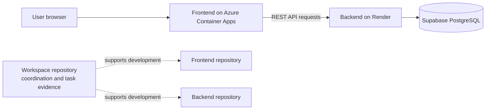
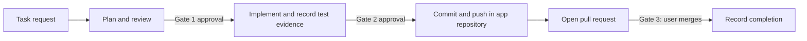

# Workspace Architecture

This repository coordinates work on the UBB Events system. The application code lives in two independent repositories under `repos/`; this repository holds the shared agent workflow, project context, and task evidence. It is not a runtime component and is not deployed.

## Repository structure

```text
AGENTS.md                 Shared agent and human-in-the-loop rules
agents/                   Planner and implementer role instructions
skills/                   Onboarding, task creation, task start, and PR workflows
context/project-context.md Shared stack, layering, and development conventions
changes/                  Task files, plans, test evidence, and corrections
docs/                     Workspace task/use-case/entity references
repos/README.md            Source of truth for application repository locations
repos/ubb-events-backend/  Independent Spring Boot backend repository
repos/ubb-events-frontend/ Independent React frontend repository
```

The two application repositories are separate Git histories and are ignored by the workspace repository. Run their build, test, and Git operations from their respective directories. The workspace itself tracks coordination material only.

## System boundary and runtime architecture

At runtime the browser loads the frontend from Azure Container Apps. The frontend calls the backend REST API directly using the build-time `VITE_API_URL`; there is no frontend development proxy. The backend runs as a Java 21 Spring Boot container on Render and connects to the project's Supabase PostgreSQL database. The backend exposes OpenAPI documentation and a health endpoint. Current deployment links and operational details are maintained in the application repository READMEs.

```text
Browser -> Azure Container Apps (Nginx static frontend)
       -> Render (Spring Boot REST API) -> Supabase PostgreSQL
```



## Configuration and deployment

This workspace has no application runtime configuration, secrets, container image, or deployment pipeline. Application configuration belongs to the relevant application repository. Keep credentials and local `.env` files out of Git. The workspace GitHub workflows and deployment automation are not defined in this repository; deployment configuration is managed by the respective hosting services and documented with each application.

## Change and traceability flow

Work is represented by task files under `changes/`. The task workflow records the plan, approval points, tests, human corrections, and design decisions. Task branches, commits, pushes, and pull requests are made inside the specific application repository. The workspace repo must not commit application repository content or rewrite application history.



## Sources and limits

This overview reflects the current workspace layout and READMEs. Requirements, detailed architecture decisions, API specification, ERD, and deployment operations remain in the team's Google Drive documentation and hosting configuration; this file is a repository-level map, not a replacement for those sources.
